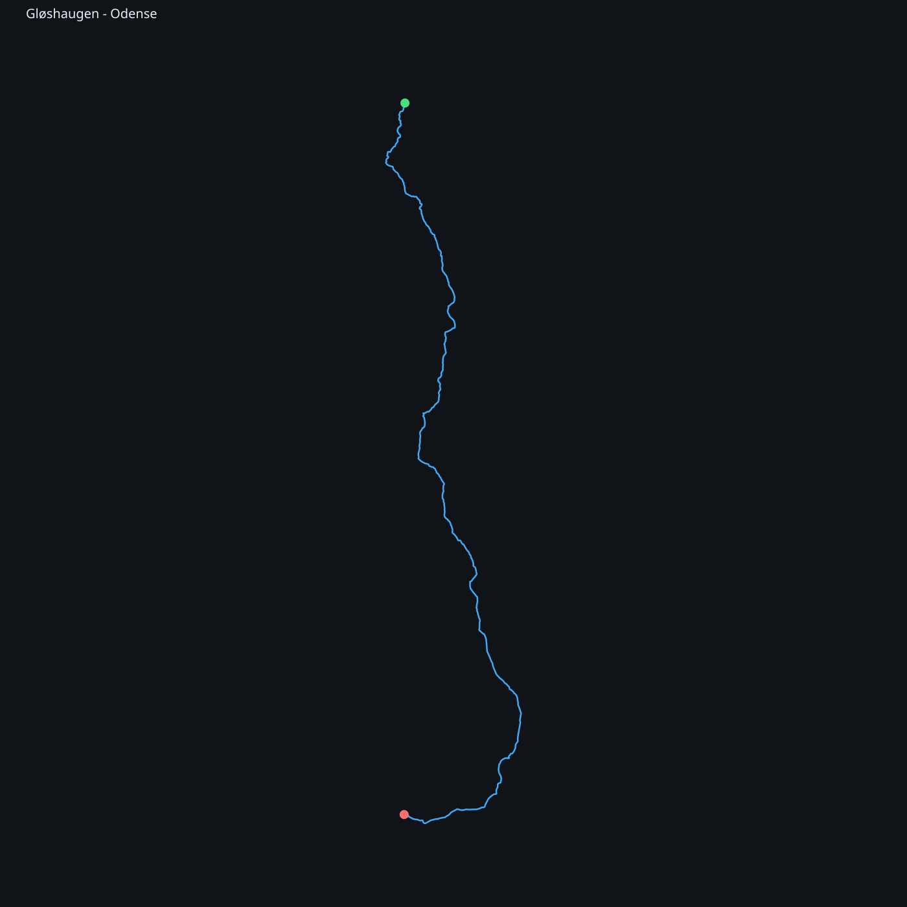
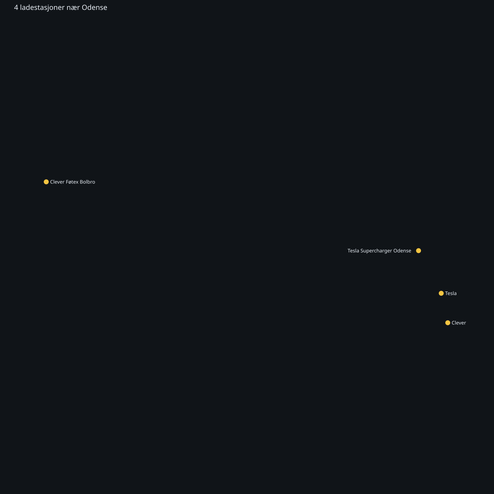
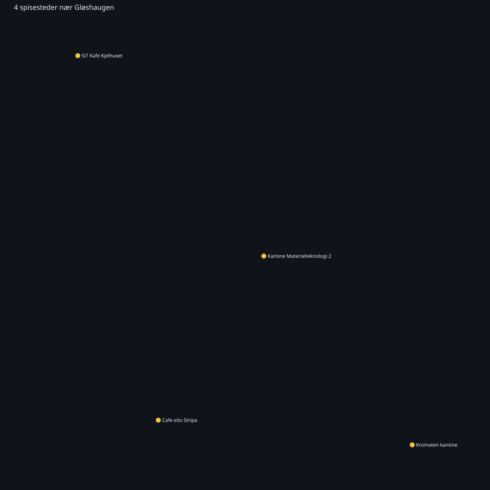

# Øving 7 - Korteste vei med Dijkstra og ALT

## Oppgaven

Programmet skal finne den raskeste bilreisa mellom to noder i et kart hentet fra OpenStreetMap, med **kjøretid** som kantvekt. Det skal gjøre to søk på samme graf:

- **Dijkstra** - vanlig Dijkstra med estimat 0.
- **ALT** - A\* med landemerker (*A\*, Landmarks, Triangle inequality*).

Søkene kan prosessere ulikt antall noder og bruke ulik tid, men de **skal gi nøyaktig samme kjøretid**. Det finnes bare én korteste kjøretid. I tillegg skal programmet telle prosesserte noder, ta tiden på søket (ikke på fillesingen), finne nærmeste interessepunkter, og tegne reisa grafisk.

## Løsningen

### Ett søk, to estimater

Hele poenget med at Dijkstra og ALT *må* gi samme svar er at de er samme algoritme med ulikt estimat. Derfor er det bare én kodevei i `SearchEngine::search`:

```cpp
const bool useEstimates = algorithm == Algorithm::Alt && landmarks_ != nullptr && landmarks_->count() > 0;
...
estimate_[next] = useEstimates ? estimate(next, target) : 0;
queue_.insertOrDecrease(next, addWeight(candidate, estimate_[next]));
```

Dijkstra er ALT med `estimate = 0`. Da kan de ikke divergere: samme graf, samme heap, samme avbruddsregel, samme avstandsarray. Det er ikke to implementasjoner som skal stemme overens - det er én.

### ALT-estimatet

For et landemerke $\ell$ gir trekantulikheten to nedre grenser for resten av reisa fra $v$ til $t$:

$$
h_\ell(v) = \max\bigl(\; d(\ell, t) - d(\ell, v),\;\; d(v, \ell) - d(t, \ell) \;\bigr)
$$

Begge ledd er lovlige fordi vektene er ikke-negative. Det første leddet bruker avstander *fra* landemerket, det andre avstander *til* landemerket. Det andre er nødvendig så snart grafen har enveiskjørte gater og rundkjøringer: da er $d(\ell, v) \neq d(v, \ell)$, og bare det ene leddet ville gitt et svakt eller feil estimat. Estimatet er maksimum over alle landemerkene:

```cpp
Weight best = 0;
for (std::size_t landmark = 0; landmark < landmarks_->count(); ++landmark) {
    const std::span<const Weight> fromLandmark = landmarks_->fromLandmark(landmark);
    const std::span<const Weight> toLandmark = landmarks_->toLandmark(landmark);

    const Weight landmarkToTarget = fromLandmark[target];
    const Weight landmarkToNode = fromLandmark[node];
    if (landmarkToTarget != INFINITE_WEIGHT && landmarkToNode != INFINITE_WEIGHT && landmarkToTarget > landmarkToNode)
        best = std::max(best, static_cast<Weight>(landmarkToTarget - landmarkToNode));

    const Weight nodeToLandmark = toLandmark[node];
    const Weight targetToLandmark = toLandmark[target];
    if (nodeToLandmark != INFINITE_WEIGHT && targetToLandmark != INFINITE_WEIGHT && nodeToLandmark > targetToLandmark)
        best = std::max(best, static_cast<Weight>(nodeToLandmark - targetToLandmark));
}
return best;
```

Estimatet avhenger bare av noden og målet, ikke av veien dit. Derfor regnes det ut **én gang**, når noden først legges i køen, og lagres i `estimate_[]`. Det er viktig: ellers ville hver enkelt kantavslapping gjort et arbeid som er lineært i antall landemerker.

### Landemerkene

Landemerkene er valgt i to trinn (`selectLandmarkCandidates`):

1. **Åtte kompassretninger.** Nord, sør, øst, vest og de fire diagonalene, hver som ytterpunktet i den retningen. Et landemerke på kanten av kartet gir de strammeste grensene, fordi trekantulikheten er skarpest når landemerket ligger omtrent på linja mellom start og mål - og et kantlandemerke ligger på den linja for enhver reise som krysser kartet.
2. **Farthest-point-sampling** hvis det trengs flere enn åtte: velg den noden som ligger lengst fra alle de valgte. Det sprer dem ut i stedet for å klumpe dem.

En node på grensa kan ligge på en liten øy eller i en blindvei, og et slikt landemerke gir ubrukelige grenser. Derfor stilles det to krav: noden må ha både inn- og utkanter, og den må nå **minst halve grafen** både framover og bakover. Kandidatlista er tre ganger så lang som ønsket antall, slik at dårlige kandidater kan forkastes. (På Island var faktisk nordligste node en isolert komponent med to noder - uten denne kontrollen ville ALT fått et elendig estimat.)

For hvert godkjent landemerke kjøres Dijkstra framover og Dijkstra på **omvendt graf** bakover. Det gir `fromLandmark_[l][v] = d(l, v)` og `toLandmark_[l][v] = d(v, l)`. Begge tabellene er flate `std::vector<Weight>` med `landmark * nodeCount + node` som indeks, altså cachevennlig og uten pekere.

Resultatet caches i `landemerker.bin` (magic `ALTNORD1`, versjon, nodeantall, så tre vektorer). Preprosesseringen tar noen minutter for Norden; cachen lastes på under et sekund.

### Prioritetskøen

Oppgaven advarer mot lineært søk i heapen. `IndexedMinHeap` holder derfor to arrayer ved siden av heapen:

- `position_[node]` - hvor i heapen noden ligger, eller `NOT_IN_HEAP`.
- `priority_[node]` - nodens nåværende nøkkel.

Det gir $O(1)$ oppslag og $O(\log n)$ `insertOrDecrease`. Sistnevnte gjør *sift-up* når nøkkelen synker, som er nettopp det tilfellet oppgaven nevner under "Feil ruter, alltid litt for lange": glemmer man å flytte noden oppover, får man mange små avstikkere fra hovedveiene. Her oppdateres `position_` hver gang en node bytter plass, så kartnoden og heapnoden peker alltid på hverandre.

### Avbruddsregel og kjøretid

Søket stopper når **målnoden tas ut av køen**, ikke når den oppdages:

```cpp
const NodeId current = queue_.popMin();
state_[current] = STATE_SETTLED;
++result.processedNodes;
if (current == target) break;
```

Det er først da avstanden er endelig. Å stoppe ved oppdagelse ville gitt feil svar på grafer med ulike kantvekter, og å kjøre til køen er tom ville brukt tiden på å finne veien til hele kartet.

Kjøretida leses rett fra `distance_[target]` når søket er ferdig. Den summeres **ikke** på nytt ved å gå gjennom ruta: det ville vært både unødvendig arbeid og feil, siden det ikke er sikkert at det er den første kanten til hver node som ble brukt.

Tidtakingen ligger rundt selve søket, ikke rundt fillesingen:

```cpp
const auto start = std::chrono::steady_clock::now();
... // søket
const auto finish = std::chrono::steady_clock::now();
result.elapsed = std::chrono::duration_cast<std::chrono::nanoseconds>(finish - start);
```

### Interessepunkter

`nearestPointsOfInterest` er ett Dijkstra-søk fra utgangspunktet som stopper så snart det har trukket ut det ønskede antallet noder fra kandidatmengden. Det er viktig at det er *ett* søk og ikke ett søk per interessepunkt: med 6171 ladestasjoner ville det siste blitt 6171 søk. En `std::vector<std::uint8_t>` med flagg per node gjør kandidattsjekken til $O(1)$.

### Datastrukturen

Grafen ligger på CSR-format (*compressed sparse row*), både framover og bakover:

```cpp
std::vector<std::size_t> forwardOffsets_;  // node -> start i targets_
std::vector<NodeId>      forwardTargets_;
std::vector<Weight>      forwardWeights_;
```

Framover brukes av søkene, bakover av Dijkstra på omvendt graf under landemerkepreprosesseringen. Koordinatene lagres som `std::int32_t` i fastpunkt med $10^{-7}$ graders oppløsning - nok for OSM, og halvparten så mye minne som `double`. Vektene er `std::uint32_t` i hundredeler av et sekund, som er presist nok til at alle referansetidene i oppgaven treffer eksakt.

Innlesingen går i to pass: først parses alle kantene inn i én `std::vector<RawEdge>` med `std::from_chars`, så bygges CSR med `std::partial_sum` og en cursor per node. Det er raskere enn å pushe per node, og det gir ingen reallokeringer underveis. Norden (7,96 mill. noder, 17,8 mill. kanter) leses på ca. 2 sekunder.

## Resultater

Alle 12 referanseturene fra oppgaven er kjørt. **Kjøretida stemmer eksakt i alle 12**, og antall noder i ruta stemmer i 11 av 12 (se kommentar under tabellen).

| Tur | Fra | Til | Noder Dijkstra | Noder ALT | Noder fasit | Kjøretid (fasit) |
|---|---|---:|---:|---:|---:|---:|
| Kårvåg-Gjemnes | 2800567 | 7705656 | 334 | 334 | 334 | 40:47 (40:47) |
| Gjemnes-Kårvåg | 7705656 | 2800567 | 334 | 334 | 334 | 40:47 (40:47) |
| Malmö Brygghus-Nørrebro | 647826 | 136530 | 408 | 408 | 408 | 32:44 (32:44) |
| Nørrebro-Malmö Brygghus | 136530 | 647826 | 410 | 410 | 410 | 33:35 (33:35) |
| Trondheim-Oslo | 7826348 | 2948202 | 1981 | 1981 | 1981 | 5:53:13 (5:53:13) |
| Oslo-Trondheim | 2948202 | 7826348 | 2030 | 2030 | 2030 | 5:53:00 (5:53:00) |
| Jyväskylä-Kárášjohka | 339910 | 1853145 | 3451 | 3451 | 3451 | 11:03:16 (11:03:16) |
| Kárášjohka-Jyväskylä | 1853145 | 339910 | 3407 | 3407 | 3407 | 11:03:54 (11:03:54) |
| Gol-Lakselv Hotell | 2503331 | 2866570 | 7518 | 7518 | 7518 | 21:07:07 (21:07:07) |
| Lakselv Hotell-Gol | 2866570 | 2503331 | 7524 | 7524 | 7524 | 21:06:48 (21:06:48) |
| Esso Sauda-Tervo | 6441311 | 3168086 | 5796 | 5791 | 5796 | 21:44:14 (21:44:14) |
| Tervo-Esso Sauda | 3168086 | 6441311 | 5820 | 5815 | 5815 | 21:45:43 (21:45:43) |

> **Om de to siste radene:** Esso Sauda-Tervo og Tervo-Esso Sauda har begge to like gode ruter med *identisk* kjøretid, og de to søkene velger hver sin. Esso Sauda-Tervo: Dijkstra 5796 noder (fasit), ALT 5791. Tervo-Esso Sauda: Dijkstra 5820, ALT 5815 (fasit). Kjøretida er 21:44:14 og 21:45:43 i begge søkene, altså eksakt som i oppgaven. Oppgaven sier uttrykkelig at "det er bare én korteste kjøretid" - ikke at det bare er én korteste rute. At de to algoritmene lander på hver sin av to like gode ruter, er derfor ikke en feil, men et utslag av hvilken kant som tilfeldigvis ble avslappet først.

### Dijkstra mot ALT

| Tur | Dijkstra noder | ALT noder | ALT/Dijkstra | Dijkstra tid | ALT tid | Fart |
|---|---:|---:|---:|---:|---:|---:|
| Kårvåg-Gjemnes | 13 406 | 2 268 | 16,9 % | 1,58 ms | 0,66 ms | 2,4× |
| Gjemnes-Kårvåg | 20 004 | 1 258 | 6,3 % | 2,28 ms | 0,18 ms | 12,8× |
| Malmö-Nørrebro | 111 607 | 54 713 | 49,0 % | 20,07 ms | 13,21 ms | 1,5× |
| Nørrebro-Malmö | 203 117 | 23 761 | 11,7 % | 67,79 ms | 20,10 ms | 3,4× |
| Trondheim-Oslo | 1 027 523 | 96 466 | 9,4 % | 216,03 ms | 32,66 ms | 6,6× |
| Oslo-Trondheim | 3 253 845 | 281 592 | 8,7 % | 844,70 ms | 51,31 ms | 16,5× |
| Jyväskylä-Kárášjohka | 2 607 364 | 281 266 | 10,8 % | 641,44 ms | 50,71 ms | 12,6× |
| Kárášjohka-Jyväskylä | 1 149 379 | 19 635 | 1,7 % | 208,07 ms | 5,17 ms | 40,2× |
| Gol-Lakselv | 7 801 017 | 1 005 795 | 12,9 % | 1854,44 ms | 324,18 ms | 5,7× |
| Lakselv-Gol | 5 388 731 | 415 293 | 7,7 % | 1227,69 ms | 69,52 ms | 17,7× |
| Esso Sauda-Tervo | 7 442 388 | 2 200 150 | 29,6 % | 1619,83 ms | 491,22 ms | 3,3× |
| Tervo-Esso Sauda | 7 507 150 | 2 203 887 | 29,4 % | 1708,76 ms | 583,69 ms | 2,9× |

ALT prosesserer mellom 1,7 % og 49 % av nodene Dijkstra gjør, og er mellom 1,5 og 40 ganger raskere. Det er nettopp oppgavens poeng: ALT leter i riktig retning i stedet for i alle retninger.

Merk at **Dijkstra på de lengste turene prosesserer nesten hele grafen** (7,8 av 7,96 mill. noder for Gol-Lakselv). Det er forventet: Dijkstra vet ikke hvor målet er, så den vokser som en sirkel til den tilfeldigvis treffer det.

At ALT er svakest på Malmö-Nørrebro (49 %) og Esso Sauda-Tervo (29,6 %) henger sammen: begge er korte reiser på tvers av en smal landmasse, der landemerkene ligger langt unna og gir lite informasjon om retningen. På de lange turene, der landemerkene faktisk ligger på linja mellom start og mål, er gevinsten stor.

### Kort tur i Trondheim

Gløshaugen (2001238) $\rightarrow$ Otilienborg (1987066): **3 min 56 s**, 53 noder i ruta. Dijkstra prosesserte 3565 noder, ALT 1279 (35,9 %). Begge fant identisk rute.

### Lang tur med grafisk framstilling

Gløshaugen (2001238) $\rightarrow$ Odense (2763740): **12 t 46 min 41 s**, 3691 noder i ruta. Dijkstra prosesserte 5 053 533 noder på 1191 ms; ALT prosesserte 994 664 noder på 221 ms - 19,7 % av nodene og 5,4× raskere. Begge fant identisk rute.



Ruta går fra Trondheim over Dovre, ned gjennom Østlandet, over Svinesund, gjennom Göteborg og videre over Storebælt til Odense. At den følger E6/E45-korridoren så presist er en god indikasjon på at vektene og grafen er riktig lest.

### Interessepunkter

**Fire ladestasjoner nærmest Odense (2763740):**

| # | Node | Reisetid | Sted |
|---:|---:|---:|---|
| 1 | 5926145 | 3:37 | Clever Føtex Bolbro |
| 2 | 3257221 | 5:47 | Tesla |
| 3 | 355152 | 6:12 | Tesla Supercharger Odense |
| 4 | 1319864 | 6:37 | Clever |



**Fire spisesteder nærmest Gløshaugen (2001238):**

| # | Node | Reisetid | Sted |
|---:|---:|---:|---|
| 1 | 1941801 | 0:33 | SiT Kafe Kjelhuset |
| 2 | 2583327 | 0:47 | Kantine Materialteknologi 2 |
| 3 | 6990844 | 0:52 | Kromaten kantine |
| 4 | 1957896 | 0:54 | Cafe-sito Stripa |



Alle fire spisestedene ligger på eller rett ved Gløshaugen, med 33-54 sekunders kjøretid. Det stemmer med virkeligheten: Kjelhuset, Materialteknologi, Kromaten og Stripa er alle på eller rundt campus.

## Om C++26

Løsningen bruker `-std=c++26` og drar nytte av:

- `std::format` for all formatert utskrift (med `std::fwrite` under, se under).
- `std::from_chars` for all tallparsing - ingen `std::stoi`, ingen `sscanf`, ingen lokalavhengige strømmer. Det er både raskere og upåvirket av `LC_NUMERIC`.
- `std::span` for alle arrayvisninger inn i CSR-strukturen, så ingen funksjon kan skrive utenfor eller ta en kopi.
- `std::ranges::reverse`, `std::ranges::fill`, `std::ranges::count_if`, `std::ranges::find` i stedet for håndskrevne løkker.
- `[[nodiscard]]` på alle rene funksjoner, `constexpr` der det er mulig, `noexcept` på det som ikke kan kaste.
- `std::optional` for "valg som ikke er gitt", `std::filesystem::path` for alle filstier.

To ting måtte løses spesielt på denne toolchainen (UCRT GCC 16.2.0):

1. **`std::print` linker ikke.** MinGW-versjonen mangler `std::__open_terminal`. `format_util.h` bruker derfor `std::format` + `std::fwrite` + `std::fflush`. Det er samme ytelse, bare uten den nye terminalintegrasjonen.
2. **`argv` er ANSI-kodet på Windows.** En tittel som "Gløshaugen" kom inn som Latin-1 og ble ugyldig UTF-8 i SVG-fila. `arguments.h` leser derfor kommandolinja på nytt med `GetCommandLineW` + `CommandLineToArgvW` og konverterer til UTF-8, og setter konsollens kodepage til UTF-8. Da virker æ, ø og å både i argumenter og i utskrift.

## Kjøring

```bash
./build                      # bygger ruting og plot
./run                        # kjører alle søkene og skriver til out/
```

Enkeltkjøringer:

```bash
./ruting --from 2001238 --to 2763740 --route out/gloshaugen-odense.csv
./ruting --near 2763740 --category ladestasjon --count 4
./plot out/gloshaugen-odense.csv out/gloshaugen-odense.svg --title "Gløshaugen - Odense"
```

Kartdataene (`noder.txt`, `kanter.txt`, `interessepkt.txt`) legges i `data/norden/` eller `data/island/`. De er ikke tatt med i innleveringen. Landemerkecachen bygges automatisk første gang og gjenbrukes etterpå; med `--rebuild-landmarks` tvinges en ny beregning.

## Filoversikt

| Fil | Innhold |
|---|---|
| `src/text_scan.h` | Rask fil- og tallparsing (`from_chars`, fastpunkt) |
| `src/format_util.h` | `write`/`writeError` - `std::format` uten `std::print` |
| `src/arguments.h` | UTF-8-kommandolinje på Windows |
| `src/graph.h/.cpp` | CSR-graf, framover og bakover, koordinater i fastpunkt |
| `src/indexed_heap.h` | Indeksert binærheap med $O(1)$-oppslag |
| `src/landmarks.h/.cpp` | Landemerkestrategi, preprosessering, binærcache |
| `src/places.h/.cpp` | Interessepunkter og kategorimasker |
| `src/search.h/.cpp` | Dijkstra/ALT i én kodevei, interessepunktsøk |
| `src/main.cpp` | Kommandolinje, sammenligningstabell, rutefil |
| `src/plot.cpp` | SVG-tegner med equirectangular projeksjon |
